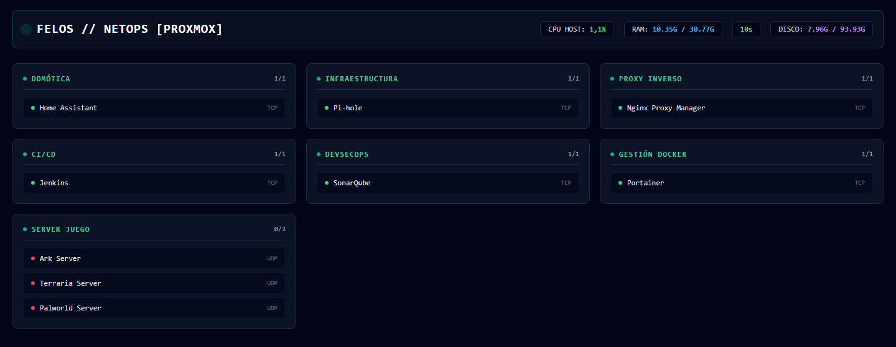

# 🖥️ Homelab Monitor

Monitor de servicios en tiempo real para infraestructura self-hosted. Agrega el estado de contenedores Docker, máquinas virtuales Proxmox y servidores de juego en un solo dashboard, combinando sondeo de red directo con métricas obtenidas desde las APIs de Portainer y Proxmox.

**Stack:** Angular 21 · Spring Boot 4 · Java 21 · Tailwind CSS · TypeScript



---

## Qué resuelve

Un homelab con varios servicios repartidos entre contenedores, VMs y máquinas físicas no tiene una vista única de estado. Portainer muestra Docker, Proxmox muestra las VMs, y los servidores de juego no aparecen en ninguno de los dos.

Este proyecto unifica las tres fuentes:

- **Sondeo de red propio** — determina si un servicio responde, independientemente de dónde corra
- **API de Portainer** — consumo de RAM por contenedor
- **API de Proxmox** — consumo de RAM por VM y métricas del nodo anfitrión

El resultado es un dashboard que agrupa por categoría, muestra latencia por servicio y se refresca automáticamente.

---

## Decisiones técnicas

### Sondeo diferenciado por protocolo

No todos los servicios se comprueban igual. El monitor aplica dos estrategias según el protocolo declarado:

- **TCP/HTTP** — apertura de socket contra el puerto real con timeout de 2 segundos. Comprobar que el puerto acepta conexiones es más fiable que un ping: la máquina puede estar viva y el servicio caído.
- **UDP** — los servidores de juego (ARK, Terraria, Palworld) no responden a una apertura de socket convencional, así que se comprueba alcanzabilidad del host mediante ICMP.

La latencia se mide como tiempo real de establecimiento de conexión, no como estimación.

### Sondeo en paralelo

El escaneo secuencial de N servicios con timeout de 2 segundos escala linealmente: nueve servicios caídos significan dieciocho segundos de espera. El controlador usa `parallelStream()` para que el tiempo total sea el del servicio más lento, no la suma de todos.

### Estado reactivo con señales de Angular

El frontend usa la API de señales de Angular (`signal`) en lugar de propiedades mutables. El polling se implementa con `timer()` de RxJS y `switchMap`, que cancela la petición anterior si aún no ha respondido cuando llega el siguiente ciclo — evitando que las respuestas lleguen fuera de orden.

Las suscripciones se limpian en `ngOnDestroy` para no dejar timers huérfanos.

### Degradación ante fallos

Si el backend deja de responder, la interfaz muestra un estado de error explícito en lugar de congelarse con datos obsoletos. El `catchError` mantiene vivo el timer, de modo que la aplicación se recupera sola cuando el backend vuelve.

---

## ⚠️ Notas de seguridad

Este proyecto está pensado para una red doméstica y hay dos decisiones que **no deben replicarse en producción**:

**1. Verificación TLS deshabilitada hacia Proxmox.** Proxmox VE usa un certificado autofirmado. `ProxmoxService` configura un `TrustManager` permisivo para poder consumir su API. Es aceptable en una LAN cerrada, pero deja la conexión expuesta a interceptación. La alternativa correcta es importar el certificado de la CA de Proxmox al truststore de la JVM.

**2. Los tokens se leen desde variables de entorno**, nunca desde el repositorio. Se recomienda crear un usuario de Proxmox con permisos de solo lectura (`PVEAuditor`) en lugar de usar un token de `root@pam`.

El endpoint de la API no tiene autenticación: está pensado para escucharse solo en la red local. Exponerlo requeriría añadir autenticación y restringir CORS.

---

## Arquitectura

```
┌──────────────────────┐         ┌───────────────────────────┐
│  Angular 21          │         │  Spring Boot 4            │
│  Signals             │  HTTP   │  MonitorController         │
│  RxJS polling (5s)   │ ──────► │       │                    │
│  Tailwind CSS        │  JSON   │       ├─ NetworkMonitor    ├──► TCP / ICMP
└──────────────────────┘ ◄────── │       ├─ PortainerService  ├──► API Portainer
                                  │       └─ ProxmoxService    ├──► API Proxmox
                                  └───────────────────────────┘
```

**Backend** — `MonitorController` orquesta las tres fuentes y devuelve un objeto unificado:

```json
{
  "services": [
    {
      "id": "jenkins",
      "name": "Jenkins",
      "category": "CI/CD",
      "protocol": "TCP",
      "status": "ONLINE",
      "latencyMs": 12,
      "ramUsage": "412 MB",
      "lastChecked": "2026-08-23T14:32:10"
    }
  ],
  "hostStatus": {
    "status": "ONLINE",
    "cpuUsage": "14%",
    "ramUsed": "18.2 GB",
    "ramTotal": "32 GB",
    "diskUsed": "41%"
  }
}
```

**Frontend** — `MonitorService` tipa esa respuesta con `MonitorResponse` (`services: ServiceNode[]`, `hostStatus: HostStatus`), sin `any` de por medio. El componente raíz agrupa por categoría y renderiza el conteo de disponibilidad por grupo.

---

## Requisitos

- Java 21+
- Node 20+ y pnpm
- Acceso de red a instancias de Portainer y Proxmox (opcional: sin ellas el monitor sigue funcionando, solo pierde las métricas de RAM)

---

## Configuración

### Backend

Crear un archivo `.env` en `homelab-monitor-backend/` a partir del ejemplo:

```bash
cd homelab-monitor-backend
cp .env.example .env
```

```properties
PORTAINER_URL=http://TU_HOST:9000
PORTAINER_TOKEN=tu_token_de_portainer
PROXMOX_URL=https://TU_HOST:8006/api2/json
PROXMOX_NODE=nombre_de_tu_nodo
PROXMOX_TOKEN=PVEAPIToken=usuario@pam!token-id=uuid
```

Levantar:

```bash
./mvnw spring-boot:run
```

La API queda en `http://localhost:8081/api/v1/monitor/services`.

### Frontend

```bash
cd homelab-monitor-frontend
pnpm install
pnpm start
```

Disponible en `http://localhost:4200`. La URL del backend se configura en `src/environments/environments.ts`.

---

## Definir los servicios a monitorear

La lista vive en el constructor de `MonitorController`. Cada entrada declara:

| Campo | Descripción |
|---|---|
| `id` | ID del contenedor en Portainer, o VMID numérico en Proxmox |
| `name` | Nombre visible en el dashboard |
| `category` | Agrupación en la interfaz |
| `protocol` | `TCP` para servicios web, `UDP` para servidores de juego |
| `address` | `ip:puerto` |

> **Mejora pendiente:** externalizar esta lista a un archivo de configuración para no requerir recompilación al añadir un servicio.

---

## Estado del proyecto

Funcional y en uso. Pendientes conocidos:

- [ ] Externalizar la lista de servicios a configuración
- [ ] Persistencia del historial de estado (hoy solo hay lectura en vivo)
- [ ] Notificaciones ante caída de un servicio
- [ ] Cobertura de tests en backend y frontend
- [ ] Contenerizar la aplicación para desplegarla en el propio homelab

---

## Licencia

MIT
